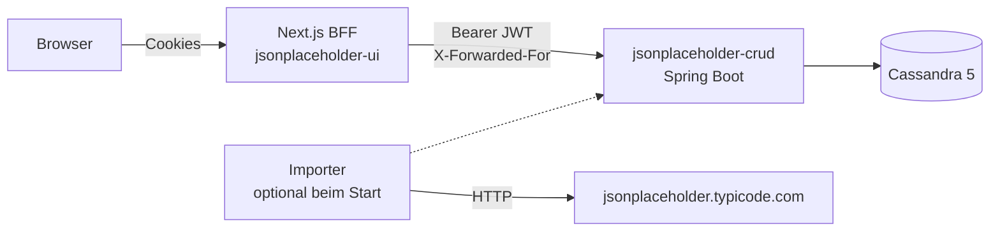
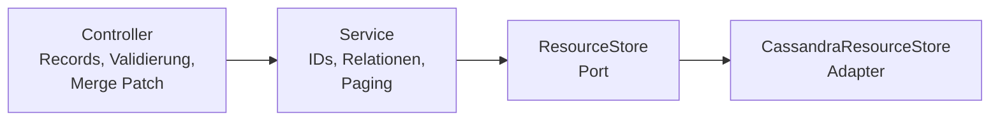

# Architektur

REST-API mit den Ressourcen von [JSONPlaceholder](https://jsonplaceholder.typicode.com) (Posts, Comments, Albums, Photos, Todos, Users), persistiert in Apache Cassandra und abgesichert per JWT. Das Frontend `jsonplaceholder-ui` (Next.js, eigenes Repository) greift als Backend for Frontend (BFF) darauf zu.

Verbindliche Regeln für Code-Änderungen stehen in [AGENTS.md](AGENTS.md); dieses Dokument erklärt den Aufbau.

## Systemkontext



Der Browser sieht keine Tokens: Der BFF hält sie in httpOnly-Cookies und ruft die API serverseitig auf.

## Technologie-Stack

| Bereich | Technologie | Version |
|---|---|---|
| Sprache, Laufzeit | Java | 25 |
| Framework | Spring Boot, Spring MVC (Tomcat) | 4.1 (Spring 7.0) |
| Persistenz | Apache Cassandra, Spring Data Cassandra | 5.0, 5.1 |
| Security | Spring Security als OAuth2 Resource Server, Nimbus JOSE (JWT HS256), BCrypt | 7.1 |
| JSON | Jackson (`tools.jackson`) | 3.1 |
| Validierung | Jakarta Bean Validation (Hibernate Validator) | 9.1 |
| API-Doku | springdoc-openapi, Swagger UI unter `/swagger-ui.html` | 3.2 |
| Boilerplate | Lombok (Getter/Setter, Konstruktor-Injection) | 1.18 |
| Tests | JUnit, Mockito, AssertJ, Testcontainers, JaCoCo | 6.0, 5.23, 3.27, 2.0, 0.8 |
| Build, lokal | Maven Wrapper, Docker Compose | |

## Paketstruktur

Basispaket `gmbh.tantive.jsonplaceholder_crud`, geschnitten nach Fachlichkeit:

| Paket | Inhalt |
|---|---|
| `post`, `comment`, `album`, `photo`, `todo`, `user` | Je Ressource: Controller, `…Request`/`…Response`-Records, Speichermodell, Service-Interface und `Default…Service` |
| `api` | Generischer `ResourceController`, `JsonMergePatcher`, `ApiExceptionHandler`, `OpenApiContractCustomizer`, Ressourcenindex `/` |
| `shared` | Verträge und generische Logik: `ResourceStore` (Port), `ResourceCrudService`, `ResourceBulkService`, `AbstractResourceService`, `Relationship`, `CollectionPage`, fachliche Exceptions |
| `persistence` | `CassandraResourceStore` (Adapter), Entities, Repositories |
| `auth` | Registrierung, Login, JWT, Refresh-Tokens, Rate-Limiting, `SecurityFilterChain` |
| `importer` | Import von JSONPlaceholder, Backfill der Relationstabelle |
| `logging`, `dev` | Access-Log ohne sensible Daten, lokaler Starter mit generiertem JWT-Secret |

## Schichten und Request-Fluss



- **Controller** kennen nur Records und das Service-Interface. PATCH wird als JSON Merge Patch (RFC 7396) auf die Request-Darstellung angewendet und wie ein PUT validiert.
- **Services** arbeiten auf dem Speichermodell, vergeben IDs und bestimmen, über welche Relationen eine Ressource auffindbar ist. Sie kennen weder HTTP noch Cassandra.
- **Der Adapter** schreibt eine Ressource und ihre Relationseinträge in einem Logged Batch.
- **Fehler** sind fachliche Exceptions, die zentral in `ProblemDetail` (`application/problem+json`) übersetzt werden.

Eine neue Ressource braucht nur ein neues Feature-Paket: Importer, Backfill und Ressourcenindex finden sie als `ResourceBulkService`-Bean.

## Datenmodell

Cassandra wird abfragegetrieben modelliert: Für jede Abfrage gibt es eine passende Partition, Abfragen sind immer durch ein Limit begrenzt. Das Schema steht ausschließlich in [`schema.cql`](src/main/resources/schema.cql), idempotent und mit dokumentierten Migrationen.

| Tabelle | Schlüssel | Zweck |
|---|---|---|
| `resources` | `(resource), id` | Alle Ressourcen als JSON-Payload, eine Partition pro Ressourcentyp, sortiert nach ID |
| `resource_relations` | `(relationship, parent_id, resource), id` | Denormalisierte Kopie des Payloads je Elternbeziehung, z. B. „Posts von User 7“ |
| `auth_accounts_by_email` | `email` | Konten mit BCrypt-Hash |
| `auth_refresh_tokens` | `token_hash` | SHA-256-Hash der Refresh-Tokens, mit TTL |
| `auth_revoked_refresh_families` | `family_id` | Widerrufene Logins, mit TTL |

Listen werden per Offset (`_start`, max. 10 000) oder per Cursor (`_after`) geblättert; der Cursor kostet pro Seite gleich viel und ist für lange Listen vorzuziehen.

## Sicherheit

- **Access-Token:** JWT (HS256, 15 Minuten), geprüft werden Signatur, Issuer, Audience und Ablauf. Das Secret kommt aus `JWT_SECRET` (mind. 256 Bit).
- **Refresh-Token:** opak, 7 Tage, nur einmal verwendbar. Eine Wiederverwendung widerruft den gesamten Login (OAuth 2.0 Security BCP).
- **Zugriff:** Alles außer `/auth/*`, `/error` und OpenAPI erfordert ein Token; ein Test prüft das automatisch für jeden Endpunkt. Ein Rollenkonzept gibt es bewusst nicht, alle Konten haben vollen Zugriff.
- **Brute-Force-Schutz:** Rate-Limit pro Client-Adresse und pro E-Mail. Die Client-Adresse kommt aus `X-Forwarded-For`, aber nur von vertrauenswürdigen Proxies (`TRUSTED_PROXIES`).
- **Kein CSRF im Backend nötig:** Die API nutzt keine Cookies; CSRF-Schutz liegt im BFF.

## Tests und Qualität

| Ebene | Werkzeug | Prüft |
|---|---|---|
| Unit | JUnit mit In-Memory-Fakes (`InMemoryResourceStore`) | Service-Regeln, Merge Patch, Token-Rotation |
| Web | `@ApiWebMvcTest` mit echter Security-Filterkette | Mapping, Validierung, Statuscodes, JSON-Form |
| Integration | `@IntegrationTest`, ein gemeinsamer Cassandra-Testcontainer | Cassandra-Verhalten, Security, OpenAPI-Vertrag |
| End-to-End | `ApplicationSmokeTest` über echtes HTTP, `scripts/smoke-test.sh` | Gesamtablauf gegen laufende Anwendung |

`mvn test` führt alles aus und schreibt den Abdeckungsbericht nach `target/site/jacoco/`.

## Lokal starten

```bash
scripts/local-app.sh start     # Cassandra (Docker Compose), Schema, App auf :8080
scripts/smoke-test.sh          # Prüfung per HTTP
scripts/local-app.sh stop
```

Daten von JSONPlaceholder importieren: einmalig mit `jsonplaceholder.import.enabled=true` starten.

## Architekturentscheidungen

| Entscheidung | Grund | Konsequenz |
|---|---|---|
| Cassandra mit JSON-Payload | Experiment mit abfragegetriebener Modellierung; Ressourcen werden immer als Ganzes gelesen | Neue Filter brauchen neue Relationspartitionen, keine Ad-hoc-Abfragen |
| Denormalisierte Relationstabelle | Listen pro Elternteil mit einer Partitionsabfrage | Doppelte Schreibvorgänge, deshalb Logged Batch; Backfill kann die Tabelle neu aufbauen |
| Ports und Adapter für die Persistenz | Fachlogik ohne Datenbank testbar | Zusätzliche Abstraktion `ResourceStore` |
| Getrennte API-Records und Speichermodelle | API und Speicherformat ändern sich unabhängig | Mapping-Code pro Ressource |
| JSON Merge Patch für PATCH | Standardisierte Semantik inkl. Entfernen mit `null` | Clients senden nur geänderte Felder |
| BFF statt Tokens im Browser | Tokens für JavaScript unerreichbar (XSS) | Logik für Proxy, Cookies und CSRF liegt im Frontend |

## Bekannte Grenzen

- **Eine Instanz:** ID-Vergabe und Rate-Limiter liegen im Speicher. Mehrere Instanzen bräuchten eine verteilte ID-Vergabe (z. B. `IF NOT EXISTS`) und ein gemeinsames Rate-Limit.
- **Parallele Refreshs:** Erneuern zwei BFF-Instanzen gleichzeitig dasselbe Refresh-Token, endet die Sitzung; der BFF bündelt Refreshs nur pro Instanz.
- **Lokale Cassandra:** `SimpleStrategy` mit Replikationsfaktor 1, für Produktion ungeeignet.
